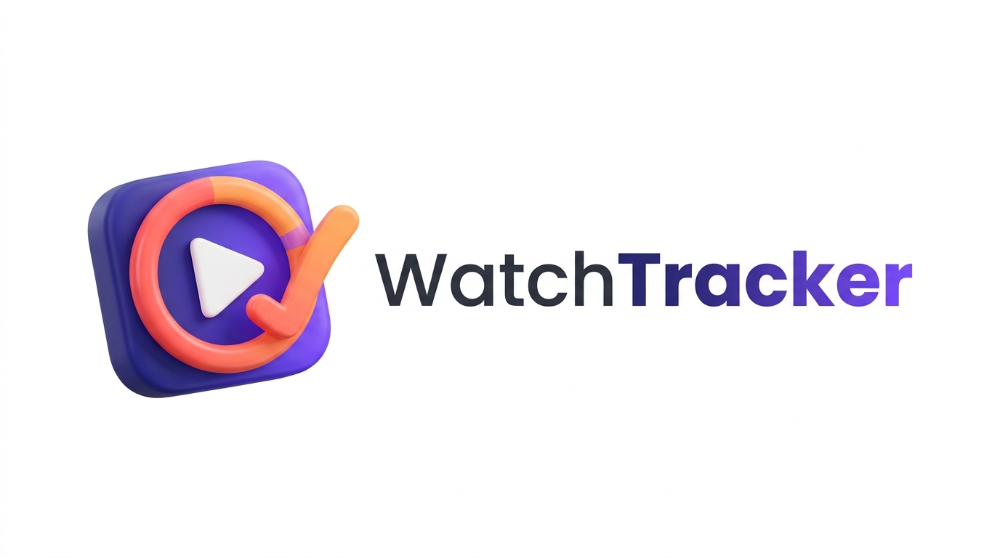
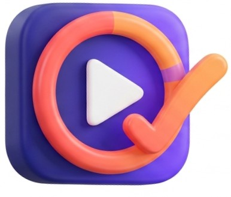

### Traccia ciò che guardi, decidilo e commentalo insieme

Un'unica libreria per **film, serie TV e anime**, con statistiche personali,
profilo pubblico condivisibile, gruppi di visione e una community moderata.

 

---

## 📑 Indice

- [Cos'è WatchTracker](#-cosè-watchtracker)
- [Perché nasce](#-perché-nasce)
- [Come funziona](#️-come-funziona)
  - [1. Registrazione e accesso](#1-registrazione-e-accesso)
  - [2. Ricerca nel catalogo](#2-ricerca-nel-catalogo)
  - [3. La libreria personale](#3-la-libreria-personale)
  - [4. Avanzamento episodio per episodio](#4-avanzamento-episodio-per-episodio)
  - [5. Rating a stelle e recensioni](#5-rating-a-stelle-e-recensioni)
  - [6. Classificazione automatica: film, serie o anime](#6-classificazione-automatica-film-serie-o-anime)
  - [7. Dashboard e statistiche](#7-dashboard-e-statistiche)
  - [8. Profilo pubblico in sola lettura](#8-profilo-pubblico-in-sola-lettura)
  - [9. Sincronizzazione tra dispositivi](#9-sincronizzazione-tra-dispositivi)
  - [10. Backup ed esportazione dei dati](#10-backup-ed-esportazione-dei-dati)
- [La community](#-la-community)
  - [Seguire altri utenti e commentare](#seguire-altri-utenti-e-commentare)
  - [Gruppi di visione](#gruppi-di-visione)
  - [Moderazione](#moderazione)
- [Le fonti dati: TMDB e Jikan](#-le-fonti-dati-tmdb-e-jikan)
- [Confronto con le alternative](#-confronto-con-le-alternative)
- [Stato del progetto](#-stato-del-progetto)

---

## 🎯 Cos'è WatchTracker

**WatchTracker** è un'applicazione web, un *watch tracker*, che permette di tenere traccia di tutto ciò che si guarda, film, serie TV e anime, e di condividerlo con altre persone.

Chi segue molti contenuti su piattaforme diverse perde facilmente il filo: a che episodio si era arrivati, quale stagione manca, quali titoli erano stati messi da parte "per dopo", se una serie seguita continuerà oppure no. WatchTracker raccoglie tutto in un unico posto, **indipendente dal servizio di streaming** su cui il contenuto viene effettivamente visto: Netflix, Prime Video, Crunchyroll, la TV o il cinema. L'app non riproduce nulla, registra e organizza ciò che l'utente guarda.

Il principio di fondo è semplice: **il catalogo dei titoli è esterno, i dati personali sono nostri**. Le informazioni sui film e sulle serie (trama, locandina, durata, generi, episodi) vengono prese da database esterni pubblici: TMDB per film e serie, MyAnimeList per gli anime. Il database gestito da noi conserva solo ciò che riguarda la persona: il suo account, cosa ha guardato e cosa sta guardando, i suoi rating, le sue recensioni, le sue statistiche.

Attorno alla libreria personale cresce una **community**: si possono seguire altri utenti, leggere e commentare le loro recensioni, e riunirsi in **gruppi di visione** per decidere insieme cosa guardare, seguire l'avanzamento comune e discutere i singoli episodi.

| 🎬 Film | 📺 Serie TV | 🎌 Anime | ⭐ Rating | 📊 Statistiche | 🔗 Profilo pubblico | 👥 Gruppi | 🛡️ Moderazione | 🔄 Sync | 💾 Backup |
|:-:|:-:|:-:|:-:|:-:|:-:|:-:|:-:|:-:|:-:|

---

## 💡 Perché nasce

Le soluzioni esistenti risolvono il problema solo in parte:

- **Letterboxd** è pensato per i film e tratta le serie in modo marginale. Le statistiche dettagliate sono riservate agli abbonati *Pro* e *Patron*.
- **Trakt** copre film e serie ma non distingue gli anime, e riserva statistiche avanzate, personalizzazione del profilo ed esportazione dei dati al piano *VIP* a pagamento.
- **MyAnimeList** è dedicato esclusivamente agli anime.

Tutte e tre sono progettate per il **singolo utente**: nessuna aiuta un gruppo di amici a scegliere cosa guardare, a seguire l'avanzamento comune e a discuterne. Chi vuole tracciare tutto deve mantenere più account su più servizi, e pagare per avere le funzioni più utili.

WatchTracker si propone di:

| | |
|---|---|
| 🧩 **Unificare** | film, serie TV e anime in un'unica libreria, con un solo account |
| 🆓 **Essere gratuito** | tutte le funzionalità, statistiche e backup compresi, senza piani a pagamento |
| 🔐 **Restituire il controllo dei dati** | l'utente può esportare tutto ciò che ha inserito, in qualsiasi momento |
| 👥 **Mettere al centro la visione condivisa** | gruppi, votazioni e discussioni per episodio |

---

## ⚙️ Come funziona

Il percorso tipico di un utente, dall'iscrizione alle statistiche.

### 1. Registrazione e accesso

L'utente crea un account con nickname, email e password e accede alla propria **area personale**. Senza accesso è possibile cercare nel catalogo, consultare i profili e le recensioni pubbliche: libreria, avanzamento, statistiche e backup richiedono di essere autenticati.

### 2. Ricerca nel catalogo

Da una barra di ricerca l'utente cerca un titolo. I risultati arrivano **in tempo reale da due cataloghi esterni**, interrogati insieme e mostrati in un'unica lista:

- **[TMDB](https://www.themoviedb.org/)** (The Movie Database) per film e serie TV, un database pubblico e collaborativo che copre la produzione di tutto il mondo;
- **[Jikan](https://jikan.moe/)**, l'API di **MyAnimeList**, per gli anime, con i metadati specifici del medium che TMDB non offre.

Per ogni risultato vengono mostrati:

| Campo | Esempio |
|---|---|
| Locandina | immagine ufficiale del titolo |
| Titolo e anno | *Arcane* (2021) |
| Tipo | Film / Serie TV / Anime |
| Trama | sinossi breve |
| Durata | minuti per i film, numero di stagioni ed episodi per le serie |
| Fonte | TMDB oppure MyAnimeList |
| Generi | Animazione, Azione, Drammatico, ... |

### 3. La libreria personale

Con un clic il titolo entra nella libreria dell'utente con uno dei quattro stati previsti.

| Stato | Significato |
|---|---|
| 📌 **Da vedere** | titolo salvato per il futuro, visione non iniziata |
| ▶️ **In corso** | visione iniziata, avanzamento tracciato |
| ✅ **Completato** | tutti gli episodi (o il film) visti |
| ⏸️ **Abbandonato** | visione interrotta volontariamente, riprendibile in qualsiasi momento |

La libreria può essere **filtrata e ordinata** per tipo (film, serie, anime), stato, genere, rating e data di aggiunta.

### 4. Avanzamento episodio per episodio

Per serie TV e anime l'utente segna gli episodi visti uno alla volta, oppure un'intera stagione in un colpo solo. WatchTracker ricava dal catalogo di origine la struttura di stagioni ed episodi, mostra a che punto si è arrivati e, quando l'ultimo episodio viene segnato, propone il passaggio automatico allo stato **Completato**.

Se la serie è ancora in produzione, l'applicazione mostra **se continuerà e quando**, usando la data del prossimo episodio o della prossima stagione, quando il catalogo la rende disponibile. Così l'utente sa se vale la pena aspettare o se la serie è finita per davvero.

### 5. Rating a stelle e recensioni

A visione conclusa l'utente assegna un **rating da una a cinque stelle** ⭐⭐⭐⭐⭐. Niente voti numerici su scale diverse per tipo di contenuto: le stelle sono immediate da capire e uguali per film, serie e anime.

Insieme al rating si può scrivere una **recensione testuale, facoltativa**. Le recensioni compaiono sul profilo pubblico dell'autore e possono essere lette e commentate dagli altri utenti.

### 6. Classificazione automatica: film, serie o anime

Ogni titolo in libreria è classificato come **film**, **serie TV** o **anime**. La classificazione è automatica e segue la fonte: ciò che arriva da MyAnimeList è un anime, ciò che arriva da TMDB è un film o una serie.

Poiché TMDB cataloga anche l'animazione giapponese, lo stesso anime può comparire in entrambi i cataloghi. Per evitare doppioni nei risultati WatchTracker applica una regola semplice:

> Un titolo TMDB con genere **Animazione** e **lingua originale giapponese** viene riconosciuto come anime e, se presente anche su MyAnimeList, viene mostrata la scheda di MyAnimeList.

Grazie alla classificazione la libreria può mostrare viste separate per i tre tipi e le statistiche possono essere calcolate per ciascuno.

### 7. Dashboard e statistiche

Dai dati raccolti WatchTracker costruisce una dashboard personale:

- ⏱️ **Ore totali di visione**, calcolate dalla durata dei film e degli episodi completati, con formattazione a scelta dell'utente (solo ore, giorni e ore, oppure "3 g 14 h").
- 🎭 **Genere preferito e distribuzione per genere**, per scoprire cosa si guarda davvero di più.
- 📅 **Titoli completati mese per mese**, per vedere l'andamento nel tempo.
- ⭐ **Rating medio** assegnato, totale e per tipo di contenuto.
- 📺 **Serie in attesa**: titoli in corso con la data del prossimo episodio, se nota.

### 8. Profilo pubblico in sola lettura

Ogni utente dispone di una **pagina pubblica in sola lettura**, raggiungibile tramite un **link condivisibile**, che mostra la sua libreria, le sue statistiche e le sue recensioni: una sorta di biglietto da visita del proprio profilo di spettatore, da mandare a un amico o mettere in bio.

La pagina è **sempre raggiungibile**, anche quando l'applicazione non è in esecuzione, e mostra l'ultima versione del profilo pubblicata dal proprietario. Chi apre il link vede ma **non può modificare nulla**: le operazioni di scrittura sono riservate al proprietario autenticato. Il profilo può essere **reso privato** in qualsiasi momento, e in quel caso il link smette di funzionare.

### 9. Sincronizzazione tra dispositivi

La libreria è legata all'**account**, non al browser o al dispositivo: accedendo da un altro browser o da un altro dispositivo che raggiunge l'applicazione si ritrova tutto, senza dover esportare o copiare nulla a mano.

### 10. Backup ed esportazione dei dati

Dall'area personale l'utente può effettuare in ogni momento un **backup completo** dei propri dati: libreria, avanzamento, rating, recensioni e impostazioni. Il file scaricato può essere conservato o **reimportato**, anche su un altro account.

Il backup è disponibile **solo all'utente autenticato**, mai dalla pagina pubblica: i dati appartengono a chi li ha inseriti, e nessun altro può scaricarli.

---

## 👥 La community

### Seguire altri utenti e commentare

Un utente può **seguire** altri utenti e vedere in una bacheca le loro attività recenti: titoli completati, nuove recensioni, rating assegnati. Le recensioni possono essere **commentate**, aprendo una discussione sotto ciascuna.

### Gruppi di visione

Più utenti possono riunirsi in un **gruppo di visione** per guardare qualcosa insieme, anche a distanza.

1. Chi crea il gruppo **invita** gli altri partecipanti e può rimuoverli.
2. I membri **propongono** titoli dal catalogo.
3. Il gruppo **vota** le proposte; chi lo gestisce apre e chiude la votazione.
4. Il titolo scelto entra nella libreria del gruppo e tutti seguono l'**avanzamento comune**.
5. Ogni episodio ha uno spazio di **discussione** dedicato, così si può commentare senza fare spoiler a chi è indietro.

### Moderazione

Recensioni e commenti sono testi scritti liberamente dagli utenti, quindi è prevista una moderazione a tre livelli:

| Livello | Cosa succede |
|---|---|
| 🚩 **Segnalazione** | qualsiasi utente può segnalare una recensione, un commento o un profilo che viola le regole della community (linguaggio esplicito, insulti, spam). |
| 🔍 **Revisione** | le segnalazioni vengono esaminate; i contenuti che violano le regole vengono rimossi e l'autore può ricevere un avviso o una sospensione temporanea. |
| ⚖️ **Ricorso** | l'autore può fare ricorso; i casi più gravi e i ricorsi vengono decisi a un livello superiore, che gestisce anche le regole della community, i nickname non consentiti e le sospensioni permanenti. |

---

## 🔎 Le fonti dati: TMDB e Jikan

WatchTracker non mantiene un proprio catalogo di titoli, ma si appoggia a due database esterni pubblici, ciascuno scelto per ciò che sa fare meglio.

| | TMDB | Jikan (MyAnimeList) |
|---|---|---|
| Copre | film e serie TV di tutto il mondo | anime |
| Punti di forza | catalogo enorme, locandine e trame in italiano, date dei prossimi episodi | distinzione tra TV, OVA, ONA e film, suddivisione in *cour*, stato "in corso", generi e temi tipici del medium, voto della community |
| Nel progetto | fonte per film e serie | fonte per anime |

Perché due fonti e non una sola:

- TMDB cataloga anche gli anime, ma li tratta come normali serie animate: raggruppa male le serie lunghe, non distingue OVA e special e non ha i generi tipici del medium. Per chi segue anime, la scheda di MyAnimeList è molto più utile.
- MyAnimeList copre solo anime, quindi da solo non basterebbe per film e serie.

WatchTracker interroga entrambi i cataloghi, unisce i risultati in un'unica lista ed elimina i doppioni. Per l'utente la ricerca è una sola.

---

## 📊 Confronto con le alternative

| | Letterboxd | Trakt | MyAnimeList | **WatchTracker** |
|---|:-:|:-:|:-:|:-:|
| Film | ✅ | ✅ | ❌ | ✅ |
| Serie TV | ⚠️ parziale | ✅ | ❌ | ✅ |
| Anime | ⚠️ solo film | ⚠️ non distinti | ✅ | ✅ |
| Avanzamento per episodio | ❌ | ✅ | ✅ | ✅ |
| Statistiche avanzate | 💰 a pagamento | 💰 a pagamento | ✅ | ✅ gratis |
| Gruppi di visione con votazione | ❌ | ❌ | ❌ | ✅ |
| Discussione per episodio | ❌ | ⚠️ limitata | ⚠️ forum | ✅ |
| Backup ed esportazione dati | ✅ | 💰 a pagamento | ✅ | ✅ gratis |
| Profilo pubblico con link | ✅ | ✅ | ✅ | ✅ |

---

## 🚧 Stato del progetto

WatchTracker è un progetto universitario per il corso di **Ingegneria del Software** dell'**Università degli Studi di Salerno**, anno accademico 2026/2027. Il Problem Statement e il Requirements Analysis Document sono nelle cartelle `Deliverables` e `Semilavorati`; questo README è l'estensione descrittiva della proposta di progetto.

Nella cartella [`webapp`](webapp/README.md) c'è il prototipo dell'applicazione (Spring Boot + HTML/CSS/JavaScript), che realizza le aree personali del RAD: account e visibilità del profilo, ricerca unificata, libreria con avanzamento per episodio e stagione, rating e recensioni, dashboard, profilo pubblico e backup. Community, gruppi di visione, moderazione e amministrazione sono descritti nei documenti ma non ancora implementati. L'applicazione non è pubblicata online: le istruzioni per avviarla in locale sono nel README della webapp.

 

 
WatchTracker · Ingegneria del Software · Università degli Studi di Salerno

